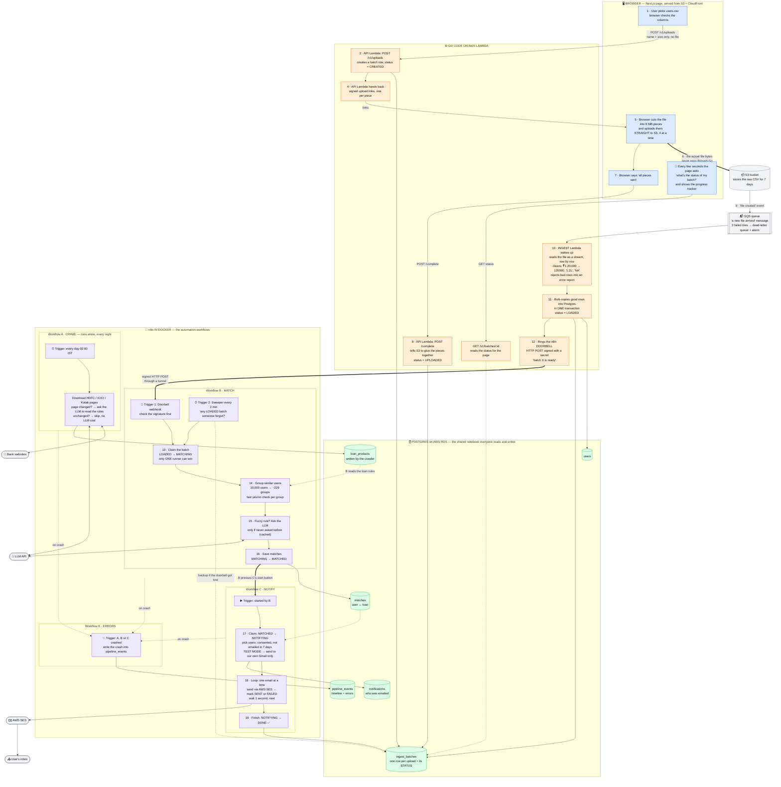

# System flow: one picture

From "I open the website" to "the user gets an email". Follow the numbers.
Colours show **who does the work**: blue = browser, orange = Go on AWS, green = database, purple = n8n in Docker.



## The batch's life, as one line

The `status` column in `ingest_batches` is the baton passed between Go and n8n:

```
CREATED ─► UPLOADED ─► PARSING ─► LOADED ─► MATCHING ─► MATCHED ─► NOTIFYING ─► DONE
└──────── Go (API + ingest Lambda) ──────┘ └─ n8n workflow B ─┘ └─ n8n workflow C ─┘
                                (anything can end in FAILED; the user can cancel → ABORTED)
```

## Who owns what

| Part | Owner | Why it lives there |
|---|---|---|
| Upload session, signed links, status API | Go (API Lambda) | Fast, cheap, needs AWS permissions |
| Moving the file bytes | Browser → S3 directly | API Gateway can't take files over 10 MB; S3 can |
| Parsing + cleaning + saving 1M rows | Go (ingest Lambda) | CPU-heavy; Go does 1M rows in ~6 s |
| Reading bank websites | n8n workflow A | The brief asks for n8n; it runs on a schedule |
| Matching users to loans | n8n workflow B | The brief asks for n8n; SQL + JS + LLM steps |
| Emails | n8n workflow C → AWS SES | The brief asks for n8n's SES node |
| Recording crashes | n8n workflow E | Built-in n8n "error workflow" feature |
| The handover between all of them | Postgres (`status` column) + the doorbell | Each side can crash without losing work |
